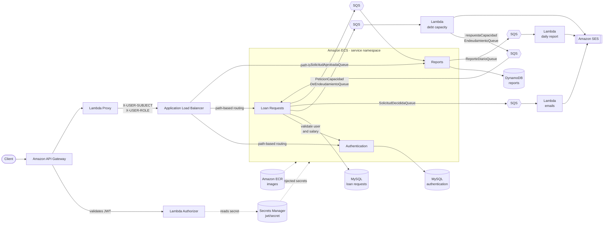
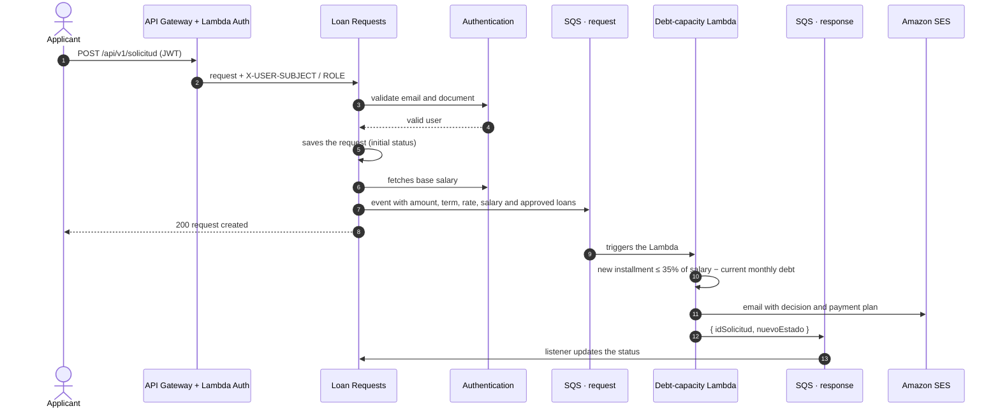

# CrediYa · Credit Evaluation Microservices Platform

> A loan-request platform built with **Spring WebFlux**, **Hexagonal Architecture (Clean Architecture)** and **event-driven messaging on AWS**. Developed as the final challenge of the **PowerUp Bootcamp by Pragma**.
>
> It was first built and validated locally with Docker Compose, then deployed to AWS using **ECR + ECS**, **Amazon API Gateway**, **Lambda**, **SQS**, **SES**, **DynamoDB** and **Secrets Manager**.

This is the **central repository**: it explains the architecture, links to every other repository and documents how to run and deploy the full solution.

---

## Table of contents

1. [What the platform does](#1-what-the-platform-does)
2. [Repository map](#2-repository-map)
3. [Architecture](#3-architecture)
4. [Business flows](#4-business-flows)
5. [SQS queues](#5-sqs-queues)
6. [API: endpoints and roles](#6-api-endpoints-and-roles)
7. [Data model](#7-data-model)
8. [User stories](#8-user-stories)
9. [Local execution](#9-local-execution-docker-compose)
10. [AWS deployment](#10-aws-deployment)
11. [Environment variables](#11-environment-variables)
12. [Observability](#12-observability)
13. [Tech stack](#13-tech-stack)

---

## 1. What the platform does

CrediYa lets users register, authenticate, submit loan requests and have them decided either **automatically** (based on debt capacity) or **manually** (by an advisor). Every decision triggers an email notification and feeds a reporting module that sends the administrator a daily summary.

| Capability | Description |
|---|---|
| Registration and login | Users with roles (`ADMINISTRADOR`, `ASESOR`, `SOLICITANTE`, `INVITADO`) and **JWT** authentication. |
| Loan requests | The applicant submits amount, term and loan type. The user is validated against the authentication service. |
| Automatic validation | A Lambda computes debt capacity (35% of base salary) and approves, rejects or sends the request to manual review. |
| Manual review | Advisors and administrators list requests (paginated and filterable) and approve or reject them. |
| Notifications | **SES** emails with the decision (plus a payment plan for automatic approvals). |
| Reports | Counter and total amount of approved requests in **DynamoDB**, with a daily email report for the administrator. |

---

## 2. Repository map

| Component | Repository | Technology | Responsibility |
|---|---|---|---|
| **Authentication** | [powerup-credit-api/Autenticacion](https://github.com/powerup-credit-api/Autenticacion) | Java 21, WebFlux, R2DBC MySQL | Users, roles, login, JWT issuance, base salary lookup |
| **Loan Requests** | [powerup-credit-api/Solicitudes](https://github.com/powerup-credit-api/Solicitudes) | Java 21, WebFlux, R2DBC MySQL, SQS | Submission, listing, status changes and event publishing |
| **Reports** | [powerup-credit-api/Reportes](https://github.com/powerup-credit-api/Reportes) | Java 21, WebFlux, DynamoDB, SQS | Approved-request metrics and scheduled daily report |
| **API Gateway (Spring) · local only** | [powerup-credit-api/ApiGateway](https://github.com/powerup-credit-api/ApiGateway) | Spring Cloud Gateway | Routing and JWT validation in the Docker Compose environment. **Not deployed to AWS**, where Amazon API Gateway + ALB take its place |
| **Databases** | [powerup-credit-api/Bases_de_datos](https://github.com/powerup-credit-api/Bases_de_datos) | MySQL 8 + `init.sql` | Images and initialization scripts for local development |
| **Lambda · debt capacity** | [powerup-credit-api/Lambda_endeudamiento](https://github.com/powerup-credit-api/Lambda_endeudamiento) | Node.js, SQS, SES | Automatic decision and payment plan |
| **Lambda · emails** | [powerup-credit-api/Email-Lambda](https://github.com/powerup-credit-api/Email-Lambda) | Node.js, SQS, SES | Decision notification to the applicant |
| **Lambda · daily report** | [powerup-credit-api/Lamda_reporte_diario](https://github.com/powerup-credit-api/Lamda_reporte_diario) | Node.js, SQS, SES | Daily summary sent to the administrator |
| **Lambda Authorizer / Proxy** | _repository pending publication_ | Node.js, Secrets Manager | JWT validation at API Gateway and forwarding to the load balancer |

---

## 3. Architecture

### 3.1 Overview (production on AWS)



**Quick read**

- **Entry:** all traffic goes through Amazon API Gateway, which validates the JWT with a Lambda Authorizer (the secret lives in Secrets Manager) and forwards the request, enriched with `X-USER-SUBJECT` and `X-USER-ROLE`, to the Application Load Balancer, which routes it by path straight to the right microservice. The Spring Cloud Gateway from the [ApiGateway](https://github.com/powerup-credit-api/ApiGateway) repository is **not part of the AWS deployment**: Amazon API Gateway, the Lambdas and the ALB cover its routing and authentication role. It is only used in the local Docker Compose setup.
- **Compute:** microservices run as containers on **ECS**, with images stored in **ECR**. They talk to each other by name through a **service discovery namespace**, with no ports exposed to the outside.
- **Asynchrony:** work that doesn't need an immediate response (automatic decision, emails, metrics) travels as events over **SQS** and is handled by Lambdas or by consumers inside the services.
- **Secrets and permissions:** sensitive values are managed in **Secrets Manager** and every component uses its own IAM role with least privilege (see [§10](#10-aws-deployment)).

### 3.2 Hexagonal architecture in each service

The three Java services share the same Gradle module layout, generated with the *Scaffold Clean Architecture* plugin:

```
service/
├── domain/
│   ├── model/          # Entities, ports (gateways) and exceptions. No framework dependencies.
│   └── usecase/        # Use cases: pure, reactive application logic (Mono/Flux).
├── infrastructure/
│   ├── driven-adapters/  # Outbound: r2dbc-mysql, dynamo-db, sqs-sender...
│   ├── entry-points/     # Inbound: reactive-web (routers, handlers, DTOs, error handling).
│   └── helpers/          # JWT security, metrics, external clients (SQS, users API).
├── applications/
│   └── app-service/      # Spring bootstrap, configuration and bean wiring.
└── deployment/
    └── Dockerfile        # Multi-stage build → JRE 21 Alpine image running as non-root user.
```

**Dependency rule:** the domain knows nothing about infrastructure. Each service ships an `ArchitectureTest` (ArchUnit) that enforces this rule on every build.

---

## 4. Business flows

### 4.1 Request with automatic validation

Applies to loan types with `validacion_automatica = TRUE` (by default *Personal loan* and *Vehicle loan*). Manually validated types (*Mortgage loan*) are left for the advisor.



**Decision rule (`Lambda_endeudamiento`)**

```
max_capacity       = base_salary × 0.35
monthly_debt       = Σ installment(client's already-approved requests)
free_capacity      = max_capacity − monthly_debt
new_installment    = P · i · (1+i)^n / ((1+i)^n − 1)     # French amortization, decimal.js arithmetic

if new_installment ≤ free_capacity:
    if amount > base_salary × 5 → REVISION_MANUAL
    else                        → APROBADO
else                            → RECHAZADO
```

### 4.2 Manual review

1. An `ASESOR` or `ADMINISTRADOR` calls `GET /api/v1/solicitud` (paginated, filterable by status and amount). Each request is enriched with the client's **base salary** and **approved monthly debt**.
2. They decide with `PUT /api/v1/solicitud?idSolicitud=...&nuevoEstado=APROBADO|RECHAZADO`.
3. Loan Requests publishes the event to `SolicitudDecididaQueue` → **email Lambda** → SES notifies the applicant.

### 4.3 Reports and daily report

1. When a request becomes `APROBADO` (by either path), Loan Requests publishes a `SolicitudAprobadaEvent` to `SolicitudAprobadaQueue`.
2. **Reports** consumes it and updates two accumulators in DynamoDB: `CONTADOR_SOLICITUDES_APROBADAS` and `MONTO_TOTAL_SOLICITUDES_APROBADAS`.
3. A scheduler (`report.cron`) reads both values and publishes them to `ReporteDiarioQueue`.
4. The **daily-report Lambda** sends the summary to the administrator through SES.

---

## 5. SQS queues

| Queue | Producer | Consumer | Content |
|---|---|---|---|
| `PeticionCapacidadDeEndeudamientoQueue` | Loan Requests | Debt-capacity Lambda | Request + base salary + client's approved requests |
| `respuestaCapacidadEndeudamientoQueue` | Debt-capacity Lambda | Loan Requests (listener) | `{ idSolicitud, nuevoEstado }` |
| `SolicitudDecididaQueue` | Loan Requests | Email Lambda | Request data and its final status |
| `SolicitudAprobadaQueue` | Loan Requests | Reports (listener) | `SolicitudAprobadaEvent` (includes the amount) |
| `ReporteDiarioQueue` | Reports (scheduler) | Daily-report Lambda | `{ contador, monto }` |

Service listeners use *long polling* (20 s, up to 10 messages) and delete a message only after it has been processed successfully.

---

## 6. API: endpoints and roles

All routes are exposed through the API Gateway (Amazon API Gateway in AWS, the Spring Cloud Gateway locally). Except for login, they require `Authorization: Bearer <token>`.

| Method | Path | Service | Allowed roles | Description |
|---|---|---|---|---|
| `POST` | `/api/v1/login` | Authentication | Public | Returns the JWT (`sub` = email, `role` claim) |
| `POST` | `/api/v1/usuarios` | Authentication | `ADMINISTRADOR` | Registers a user |
| `GET` | `/api/v1/validar` | Authentication | Service-to-service / `ADMINISTRADOR` | Checks a user exists by email and document |
| `GET` · `POST` | `/api/v1/salario` | Authentication | Service-to-service / `ADMINISTRADOR` | Base salary by email, or for a list of emails |
| `POST` | `/api/v1/solicitud` | Loan Requests | `SOLICITANTE`, `ASESOR`, `ADMINISTRADOR` | Submits a request (body email must match the token's) |
| `GET` | `/api/v1/solicitud` | Loan Requests | `ASESOR`, `ADMINISTRADOR` | Paginated list: `page`, `size`, `monto`, `estado`, `sortDirection` |
| `PUT` | `/api/v1/solicitud` | Loan Requests | `ASESOR`, `ADMINISTRADOR` | Changes status: `idSolicitud`, `nuevoEstado` |
| `GET` | `/api/v1/reportes/total` | Reports | `ASESOR`, `ADMINISTRADOR` | Total approved requests |
| `GET` | `/api/v1/reportes/monto` | Reports | `ASESOR`, `ADMINISTRADOR` | Total approved amount |

Each service publishes its OpenAPI documentation at `/swagger-ui.html`.

**Quick example**

```bash
# 1. Login
curl -X POST "$BASE_URL/api/v1/login" \
  -H "Content-Type: application/json" \
  -d '{"email":"user@example.com","contrasena":"********"}'

# 2. Create a request
curl -X POST "$BASE_URL/api/v1/solicitud" \
  -H "Authorization: Bearer $TOKEN" \
  -H "Content-Type: application/json" \
  -d '{
        "email": "user@example.com",
        "documentoIdentidad": "123456789",
        "monto": 5000000,
        "plazo": 24,
        "tipoPrestamo": "PRESTAMO PERSONAL"
      }'
```

---

## 7. Data model

**MySQL · `autenticacion` database**

| Table | Main fields |
|---|---|
| `rol` | `id_rol`, `nombre` (`ADMINISTRADOR`, `ASESOR`, `SOLICITANTE`, `INVITADO`), `descripcion` |
| `usuario` | `id_usuario`, `nombres`, `apellidos`, `email` (unique), `documento_identidad` (unique), `telefono`, `direccion`, `salario_base` (0 – 15,000,000), `rol_id`, `contrasena` (BCrypt), `fecha_nacimiento` |

**MySQL · `solicitudes` database**

| Table | Main fields |
|---|---|
| `estado` | `PENDIENTE_DE_REVISION`, `REVISION_MANUAL`, `APROBADO`, `RECHAZADO` |
| `tipo_prestamo` | `nombre`, `monto_minimo`, `monto_maximo`, `tasa_interes`, `validacion_automatica` |
| `solicitud` | `id_solicitud`, `documento_identidad`, `email`, `monto`, `plazo`, `id_estado`, `id_tipo_prestamo`, `fecha_creacion` |

**DynamoDB · `reportes` table:** two accumulator items (`CONTADOR_SOLICITUDES_APROBADAS` and `MONTO_TOTAL_SOLICITUDES_APROBADAS`).

Creation scripts and seed data live in [Bases_de_datos](https://github.com/powerup-credit-api/Bases_de_datos).

---

## 8. User stories

| HU | Description | Status |
|---|---|---|
| 1 | User registration with validations (required fields, email, salary range) | ✅ |
| 2 | Loan request registration with initial status | ✅ |
| 3 | JWT authentication and role-based access control | ✅ |
| 4 | Request listing for manual review (paginated and filterable) | ✅ |
| 5 | Containerization: one Dockerfile per service and `docker-compose` | ✅ |
| 6 | Manual approval/rejection with email notification through SQS | ✅ |
| 7 | Automatic debt-capacity validation with Lambda | ✅ |
| 8–9 | Reports microservice (DynamoDB + SQS consumer) | ✅ |
| 10 | AWS deployment: ECR, ECS, API Gateway and service-to-service security | ✅ |
| 11 | Automated daily email report | ✅ |

---

## 9. Local execution (Docker Compose)

The solution started locally. The `docker-compose.yml` in this repository brings up **Authentication, Loan Requests, the Spring Cloud Gateway and both MySQL databases** on an internal network. Here the Gateway plays the role that Amazon API Gateway, the Lambdas and the ALB play in AWS.

### Prerequisites

- [Docker](https://www.docker.com/get-started) and Docker Compose
- Git

### Steps

```bash
# 1. Clone this repo and, inside it, each service using the folder names the compose file expects
git clone https://github.com/powerup-credit-api/CrediYa.git   # ← adjust to this repo's name
cd CrediYa
git clone https://github.com/powerup-credit-api/Autenticacion   autenticacion
git clone https://github.com/powerup-credit-api/Solicitudes     solicitudes
git clone https://github.com/powerup-credit-api/ApiGateway      api-gateway
git clone https://github.com/powerup-credit-api/Bases_de_datos  bases_de_datos
git clone https://github.com/powerup-credit-api/Reportes        reportes

# 2. Build the database images (the compose file references them by name)
docker build -t dbautenticacion ./bases_de_datos/Autenticacion
docker build -t dbsolicitudes   ./bases_de_datos/Solicitudes

# 3. Start everything
docker-compose up --build
```

| Service | Local URL |
|---|---|
| Spring Cloud Gateway (local only) | http://localhost:8080 |
| Loan Requests | http://localhost:8081 |
| Authentication | http://localhost:8082 |
| Reports | http://localhost:8083 (see note) |

> **About AWS services locally.** SQS, SES and DynamoDB are not part of the compose file. To exercise the asynchronous flows you can (a) point to real queues in a development AWS account using your credentials, or (b) use [LocalStack](https://localstack.cloud/) and override the queue URLs with the variables in [§11](#11-environment-variables). Reports uses the Spring profile `local` for local DynamoDB and `local-cloud` for AWS.
>
> The Lambdas can be tested in isolation: the `Lambda_endeudamiento` and `Email-Lambda` repositories include a `test.js` and a sample event.

---

## 10. AWS deployment

### 10.1 Components used

| AWS service | Usage |
|---|---|
| **ECR** | One repository per microservice; stores the images built from each `Dockerfile`. |
| **ECS** | Runs the containers. One task definition and one service per microservice. |
| **Service namespace (Cloud Map)** | Internal discovery: Loan Requests calls Authentication by service name, not by IP. |
| **Application Load Balancer** | Cluster entry point; routes requests by path to the target group of each microservice. |
| **Amazon API Gateway** | Public entry to the API. Integrates the Lambda Authorizer and the Lambda Proxy. |
| **Lambda** | Authorizer, proxy, automatic decision, emails and daily report. |
| **SQS** | Messaging between services and Lambdas (see [§5](#5-sqs-queues)). |
| **SES** | Transactional emails and the daily report. |
| **DynamoDB** | Persistence for the Reports metrics. |
| **Secrets Manager** | Central store for sensitive values (JWT secret, credentials). |
| **CloudWatch** | Container and Lambda logs. |

Region: **`us-east-2`**.

### 10.2 Publishing an image to ECR

```bash
AWS_REGION=us-east-2
ACCOUNT_ID=<your-account-id>
REPO=solicitudes        # autenticacion | solicitudes | reportes

aws ecr get-login-password --region $AWS_REGION \
  | docker login --username AWS --password-stdin $ACCOUNT_ID.dkr.ecr.$AWS_REGION.amazonaws.com

docker build -t $REPO -f deployment/Dockerfile .
docker tag  $REPO:latest $ACCOUNT_ID.dkr.ecr.$AWS_REGION.amazonaws.com/$REPO:latest
docker push $ACCOUNT_ID.dkr.ecr.$AWS_REGION.amazonaws.com/$REPO:latest
```

Then update the ECS service with *force new deployment* so it picks up the new image.

### 10.3 Secrets management

Locally, secrets are plain environment variables in the compose file. In AWS, no sensitive value is baked into images or committed to the repositories:

| Secret | Where it lives | Who consumes it | How |
|---|---|---|---|
| `jwt/secret` (`JWT_SECRET`) | Secrets Manager | Lambda Authorizer, Lambda Proxy | Read at runtime with `GetSecretValue` and cached in memory between invocations |
| `JWT_SECRET` | Secrets Manager | Authentication, Loan Requests, Reports | Injected into the ECS task definition as a *secret*, so it reaches the container as an environment variable |
| Database credentials (`MYSQL_USER`, `MYSQL_PASSWORD`) | Secrets Manager | Authentication, Loan Requests | Injected into the ECS task definition as secrets |

Key points:

- The **same JWT secret** signs tokens in Authentication and validates them in the Lambdas and in the services, so it has a single source of truth and can be rotated in one place.
- The ECS **execution role** is allowed `secretsmanager:GetSecretValue` only on the secrets its tasks need.
- Non-sensitive configuration (queue URLs, ports, region, cron) stays as plain environment variables in the task definition.

### 10.4 Permission management (IAM)

Roles are split by responsibility, following least privilege:

| Role | Main permissions |
|---|---|
| ECS **execution role** | Pull images from ECR, write logs to CloudWatch, read the required secrets |
| **Task role · Loan Requests** | `sqs:SendMessage` and `sqs:ReceiveMessage`/`DeleteMessage` on its queues |
| **Task role · Reports** | Read/write on the `reportes` DynamoDB table; `sqs:Receive/Delete` on `SolicitudAprobadaQueue`; `sqs:SendMessage` on `ReporteDiarioQueue` |
| **Role · Debt-capacity Lambda** | Read its queue, `ses:SendEmail`, `sqs:SendMessage` to the response queue |
| **Role · Email / daily-report Lambdas** | Read their queue and `ses:SendEmail` |
| **Role · Lambda Authorizer / Proxy** | `secretsmanager:GetSecretValue` on `jwt/secret` |

In addition, security groups only allow the ALB to reach the services, and the databases only accept traffic from the ECS tasks.

### 10.5 Suggested order to reproduce the deployment

1. Create the SQS queues and the DynamoDB table.
2. Verify the sender identity (email or domain) in SES.
3. Create the secrets in Secrets Manager (`jwt/secret` and database credentials).
4. Deploy the three business Lambdas and attach them as triggers of their queues.
5. Create the ECR repositories, push the images and register task definitions and services in ECS inside the namespace.
6. Create the ALB with path-based listener rules, one target group per microservice.
7. Create the API Gateway with the Lambda Authorizer and the Lambda Proxy toward the ALB.

---

## 11. Environment variables

| Variable | Service | Description |
|---|---|---|
| `JWT_SECRET` | Authentication, Loan Requests, Reports, Gateway (local) | Shared HMAC secret to sign and validate the JWT |
| `JWT_EXPIRATION` | Authentication | Token lifetime in ms (default `3600000`) |
| `MYSQL_HOST` · `MYSQL_PORT` · `MYSQL_DATABASE` · `MYSQL_USER` · `MYSQL_PASSWORD` · `MYSQL_SSL_ENABLED` | Authentication, Loan Requests | R2DBC connection |
| `USUARIO_API_URL` | Loan Requests | Base URL of the Authentication service |
| `AWS_SQS_EMAIL` | Loan Requests | URL of `SolicitudDecididaQueue` |
| `AWS_SQS_VALIDACION` | Loan Requests | URL of `PeticionCapacidadDeEndeudamientoQueue` |
| `AWS_SQS_RESPUESTA` | Loan Requests | URL of `respuestaCapacidadEndeudamientoQueue` |
| `AWS_SQS_SOLICITUD_APROBADA` | Loan Requests, Reports | URL of `SolicitudAprobadaQueue` |
| `AWS_SQS_REPORTE_DIARIO` | Reports | URL of `ReporteDiarioQueue` |
| `REPORT_CRON` | Reports | Cron expression (Spring 6-field format) for the daily report |
| `SERVICES_AUTH_URI` · `SERVICES_SOLICITUDES_URI` · `SERVICES_REPORTES_URI` | Gateway (local only) | Internal URIs of each service |
| `SERVICES_AUTH_PUBLIC_PATHS` · `SERVICES_AUTH_PRIVATE_PATHS` · `SERVICES_SOLICITUDES_PATHS` · `SERVICES_REPORTES_PRIVATE_PATHS` | Gateway (local only) | Paths exposed per service |
| `SES_FROM_EMAIL` | Email Lambdas | Verified sender in SES |
| `REPORTE_TO_EMAIL` | Daily-report Lambda | Recipient of the summary |
| `RESULTADOS_QUEUE_URL` | Debt-capacity Lambda | Queue where it publishes the decision |

> Never commit secrets. Locally use a `.env` file (ignored by Git); in AWS use Secrets Manager as described in [§10.3](#103-secrets-management).

---

## 12. Observability

- **Health and metrics:** every service exposes `/actuator/health` and `/actuator/prometheus`.
- **Documentation:** Swagger UI at `/swagger-ui.html` on each service.
- **Logs:** `Log4j2` in the services and `console` in the Lambdas, centralized in CloudWatch.
- **Errors:** a `GlobalExceptionHandler` per service maps domain exceptions to consistent HTTP responses.

---

## 13. Tech stack

- **Languages:** Java 21 · Node.js (Lambdas)
- **Frameworks:** Spring Boot 3.5 · Spring WebFlux · Spring Security · Spring Cloud Gateway (local) · Project Reactor
- **Persistence:** MySQL 8 (R2DBC) · Amazon DynamoDB
- **Messaging and email:** Amazon SQS · Amazon SES
- **Containers and cloud:** Docker · Amazon ECR · Amazon ECS · API Gateway · Lambda · IAM · Secrets Manager · CloudWatch
- **Quality:** JUnit 5 · Mockito · Reactor Test · ArchUnit · JaCoCo
- **Build:** Gradle (multi-module)

---

## Credits

Project developed as part of the **PowerUp Bootcamp by Pragma**.
Author: _add your name and contact links here_.
